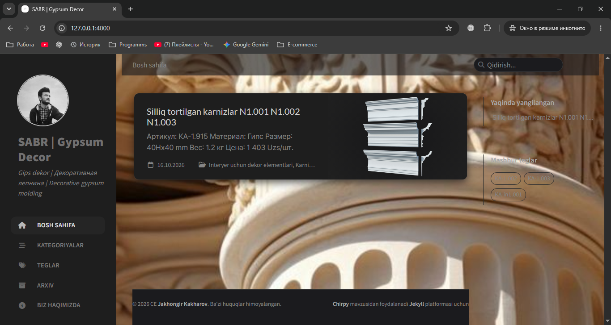
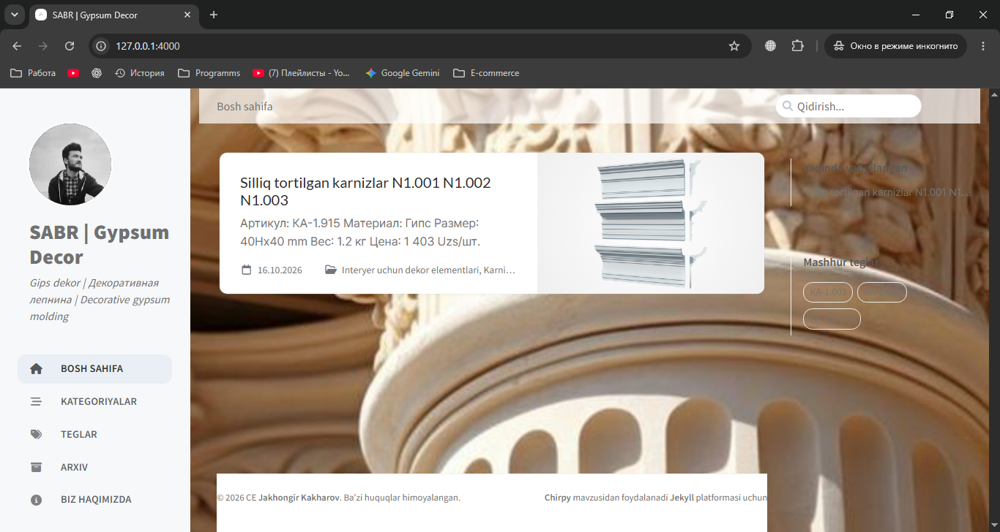

## 1. Olingan web sahifa

- [Olingan sayt](https://mrkakharov.github.io/)
- [Sayt uchun github repozitoriya](https://github.com/sabr-gypsum-decor/sabr-gypsum-decor.github.io)
- [Sayt uchun fayllar saqlash repozitoriyasi](https://github.com/sabr-gypsum-decor/sabr-gypsum-decor.catalog)

- Terminalda tekshirish kodlari:
  - Tozalash kodi:
    ```bash
    bundle exec jekyll clean
    ```
  - Ishga tushirish kodi:
    ```bash
    bundle exec jekyll s -l -H 127.0.0.1
    ```

## 2. Chirpy Dark va light mavzulari css larini o'zgartirish(Hamma o'zgarishlar `_sass` papkasida bo'ladi)

  - ## 2-abstracts
    - _breakpoints.scss
    - _index.scss
    - `_mixins.scss` faylidagi o'zgarishlar(bularni eng pastiga qo'shing. 
    Saytda hechnima sodir bo'lmaydi chunki bu mixenlar ma'lum qismga ulangandagina ishlaydi):
      ```scss
      /* --- Background Image with Blur Mixin (Mavzu ranglariga ulangan) --- */
      @mixin bg-image-blur(
        $img-path: '/assets/img/background/background.jpg',
        $blur: 10px,
        $overlay-color: var(--main-bg) // Mavzuning o'z fon rangi overlay sifatida olinadi
      ) {
        position: relative;
        overflow: hidden;

        &::before {
          content: '';
          position: absolute;
          top: -$blur * 2;     // Xiralashganda chetlarda oq chiziqlar hosil bo'lmasligi uchun
          left: -$blur * 2;
          right: -$blur * 2;
          bottom: -$blur * 2;
          background-image: url($img-path);
          background-size: cover;
          background-position: center;
          background-repeat: no-repeat;
          background-attachment: fixed;
          filter: blur($blur);
          transform: scale(1.05); // Chetlarni tekislash uchun
          z-index: -1;
        }

        // Mavzu rejimiga qarab avtomatik moslashuvchi overlay
        @if $overlay-color {
          &::after {
            content: '';
            position: absolute;
            top: 0;
            left: 0;
            right: 0;
            bottom: 0;
            // Mavzu foniga biroz shaffoflik qo'shib yopamiz (masalan, qorong'i rejimda qoramtir, yorug'da ochiqroq tus oladi)
            background: $overlay-color; 
            opacity: 0.35; // Overlay qanchalik quyuq/ochiq bo'lishini shu yerdan boshqarasiz (0 dan 1 gacha)
            z-index: -1;
          }
        }
      }

      /* --- Mavzu o'zgaruvchilariga ulangan va shaffof (Glass) effekti bor Mixin --- */
      @mixin glass-bg(
        $bg: var(--sidebar-bg), 
        $border: var(--main-border-color), 
        $blur: 16px,
        $radius: 0px
      ) {
        // Mavzu rangini 70% qalinlikda, qolganini shaffof qilib beradi
        background: color-mix(in srgb, $bg 75%, transparent) !important;
        border: 1px solid $border;
        border-radius: $radius;
        
        -webkit-backdrop-filter: blur($blur) saturate(180%);
        backdrop-filter: blur($blur) saturate(180%);
        box-shadow: 0 8px 32px rgba(0, 0, 0, 0.2);

        @supports not (backdrop-filter: blur(1px)) {
          background: var(--main-bg, #0f172a) !important;
        }
      }
      ```
    - _placeholders.scss
    - _variables.scss
  - ## 1-base
    - `_base.scss` faylidagi o'zgarishlar
        ```scss
        body {
          background: var(--main-bg);
  
          /* --- Mana bu qatorlarni qo'shing --- */
          @include mx.bg-image-blur;
          /* ---------------------------------- */
          
          padding: env(safe-area-inset-top) env(safe-area-inset-right)
            env(safe-area-inset-bottom) env(safe-area-inset-left);
          color: var(--text-color);
          -webkit-font-smoothing: antialiased;
          font-family: v.$font-family-base;
        }
        ```
      - Satydagi o'zgarish:
        
    - _index.scss
    - _reset.scss
    - _syntax.scss
    - _typography.scss
  - ## components
  - _buttons.scss
  - _index.scss
  - _popups.scss
  - ## layout
  - _footer.scss
  - _index.scss
  - _panel.scss
  - _sidebar.scss
  - _topbar.scss
  - ## main.bundle.scss
  - ## main.scss
  - ## pages
  - _archives.scss
  - _categories.scss
  - _category-tag.scss
  - _home.scss
  - _index.scss
  - _post.scss
  - _search.scss
  - _tags.scss
  ## themes
  - _dark.scss
  - _light.scss

## 3. Post yozish

- [coc-markmap](https://github.com/gera2ld/coc-markmap) for Neovim
- [markmap-vscode](https://marketplace.visualstudio.com/items?itemName=gera2ld.markmap-vscode) for VSCode
- [eaf-markmap](https://github.com/emacs-eaf/eaf-markmap) for Emacs

## Features

Note that if blocks and lists appear at the same level, the lists will be ignored.

### Lists

- **strong** ~~del~~ *italic* ==highlight==
- `inline code`
- [x] checkbox
- Katex: $x = {-b \pm \sqrt{b^2-4ac} \over 2a}$ <!-- markmap: fold -->
  - [More Katex Examples](#?d=gist:af76a4c245b302206b16aec503dbe07b:katex.md)
- Now we can wrap very very very very long text with the `maxWidth` option
- Ordered list
  1. item 1
  2. item 2

### Blocks

```js
console.log('hello, JavaScript')
```

| Products | Price |
|-|-|
| Apple | 4 |
| Banana | 2 |


uz.yml ga maxsulotni qo'shish

product:
  article: "Artikul(raqami):"
  size: "O'lchamlari(mm):"
  color: "Rangi va teksturasi:"
  weight: "Vazni(kg):"
  style: "Uslubi:"
  price: "Narxi(uzs/metr):"
  material: "Material"
  3d_view: "3D ko'rinishi"
  img_view: "Rasmlar"
  availability: "Mavjudligi:buyurtma asosida tayyorlanadi"
  delivery: "Yetkazib va qadoqlash kelishuv bo'yicha"
